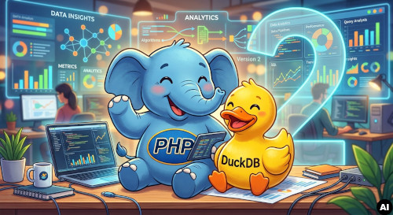
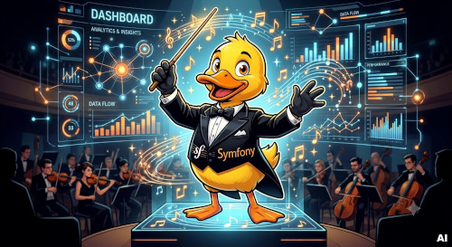
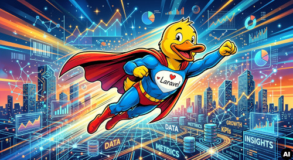
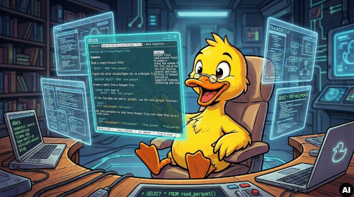
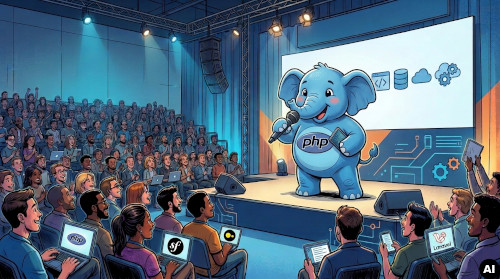

### Stable:

PHP PDO Driver for DuckDB:
https://github.com/thomas-0816/pdo-duckdb-php

Doctrine DBAL for DuckDB:
https://github.com/thomas-0816/doctrine-dbal-duckdb

Laravel Eloquent driver for DuckDB:
https://github.com/thomas-0816/laravel-duckdb

opencode-v2-tool-search:
https://github.com/thomas-0816/opencode-v2-tool-search

### Testing:

Cli for viewing and searching docs for DuckDB,\
includes semantic search:

https://github.com/thomas-0816/duckdb-web-cli

 

### Proof of concept:

DuckDB WASM Shell + Wllama Chat, WebGPU:
https://github.com/thomas-0816/duckdb-wasm-shell-wllama

### Latest Talks:

[Run LLMs locally](https://github.com/thomas-0816/talks/blob/main/Run_LLMs_Locally_2026_ThomasBley.pdf)

[Run LLMs locally in the browser](https://github.com/thomas-0816/talks/blob/main/Run_LLMs_Locally_in_the_browser_2026_ThomasBley_iJS_2026.pdf)

[From Redis to Apache KVRocks](https://github.com/thomas-0816/talks/blob/main/From_Redis_To_Apache_KVRocks_2026_ThomasBley.pdf)

[HTMX](https://github.com/thomas-0816/talks/blob/main/HTMX_phpugmrn_2025_ThomasBley.pdf)

 
